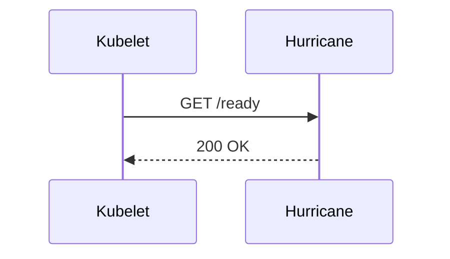

# 🌪️ Django Hurricane Documentation (Docus)

This directory contains the documentation site for Django Hurricane, built with **[Docus](https://docus.dev/)**, **Nuxt 3**, **Nuxt Content**, **Tailwind / Nuxt Tokens**, and **Mermaid**.

---

## 🚀 Local Development

### 1. Prerequisites
- **Node.js**: v18.0.0 or later (v20+ recommended).
- **npm**: v9.0.0 or later.

### 2. Install Dependencies
```bash
cd docs
npm install
```

### 3. Start Development Server
```bash
npm run dev
```
Open [http://localhost:3000](http://localhost:3000) in your browser. Docus features full Hot Module Replacement (HMR)—any edits in `content/` will immediately update in your browser.

---

## 📝 Content Organization

Documentation files live in `docs/content/` as Markdown documents with frontmatter:

```text
docs/content/
├── index.md                      # Landing page (root /)
├── 1.concepts/                   # Core architectural concepts
│   ├── index.md
│   ├── 1.kubernetes-probes.md
│   ├── 2.rust-engine.md
│   ├── 3.fast-404-protection.md
│   ├── 4.rate-limiting.md
│   ├── 5.shared-memory-metrics.md
│   └── 6.webhooks.md
├── 2.guides/                     # Tutorials and guides
│   ├── index.md
│   ├── 1.getting-started.md
│   ├── 2.developer-guide.md
│   └── 3.kubernetes-deployment.md
└── 3.configuration/              # Configuration reference
    └── index.md
```

*Note: Number prefixes (e.g. `1.concepts`, `1.kubernetes-probes.md`) control navigation order in the sidebar and are automatically stripped from URLs.*

---

## 📊 Using Mermaid Diagrams

Mermaid diagrams render client-side in both dark and light modes. You can use standard Markdown code fences:

````markdown

````

Or the MDC block component:

```markdown
::mermaid
graph TD
    A[Start] --> B{Check}
    B -- Yes --> C[OK]
    B -- No --> D[Error]
::
```

---

## 🏗️ Generating Static HTML for GitHub Pages

To create a static production build ready for deployment on GitHub Pages or Cloudflare Pages:

```bash
cd docs
npm run generate
```

This compiles your Markdown, Vue components, and assets into the `.output/public/` folder.

To preview the production build locally:
```bash
npx serve .output/public
```

---

## 🤖 GitHub Actions Workflow for GitHub Pages

To automatically build and deploy this documentation site on every commit to `main`, add `.github/workflows/docs.yml`:

```yaml
name: Deploy Documentation to GitHub Pages

on:
  push:
    branches:
      - main
    paths:
      - 'docs/**'
  workflow_dispatch:

permissions:
  contents: read
  pages: write
  id-token: write

concurrency:
  group: "pages"
  cancel-in-progress: false

jobs:
  build-and-deploy:
    environment:
      name: github-pages
      url: ${{ steps.deployment.outputs.page_url }}
    runs-on: ubuntu-latest
    steps:
      - name: Checkout
        uses: actions/checkout@v4

      - name: Setup Node.js
        uses: actions/setup-node@v4
        with:
          node-version: 20
          cache: 'npm'
          cache-dependency-path: 'docs/package-lock.json'

      - name: Install dependencies
        run: |
          cd docs
          npm ci

      - name: Generate Static Site
        run: |
          cd docs
          npm run generate

      - name: Upload artifact
        uses: actions/upload-pages-artifact@v3
        with:
          path: 'docs/.output/public'

      - name: Deploy to GitHub Pages
        id: deployment
        uses: actions/deploy-pages@v4
```
