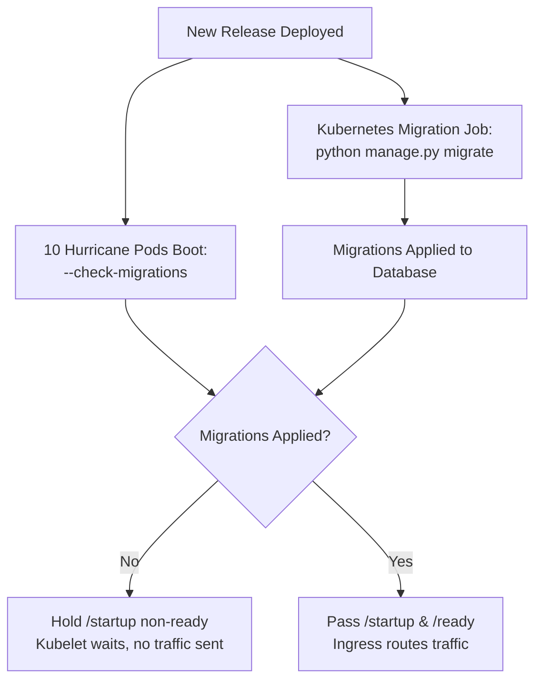
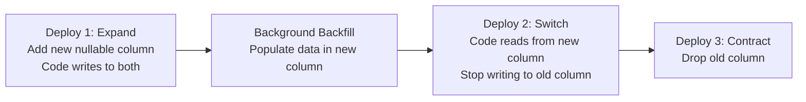

# Django on Kubernetes: The Complete Production Guide

Deploying Django applications into production Kubernetes clusters requires harmonizing Django's application lifecycle with Kubernetes container orchestration: synchronizing database migrations, establishing robust probe lifecycles, and configuring isolated ports for health monitoring.

---

## Production Deployment Manifest

```yaml [deployment.yaml]
apiVersion: apps/v1
kind: Deployment
metadata:
  name: django-app
  labels:
    app: django-app
spec:
  replicas: 3
  selector:
    matchLabels:
      app: django-app
  template:
    metadata:
      labels:
        app: django-app
    spec:
      containers:
      - name: django
        image: my-registry.com/my-django-app:v1.0.0
        imagePullPolicy: IfNotPresent
        command:
        - "python"
        - "manage.py"
        - "serve"
        - "--port=8000"
        - "--probe-port=8001"
        - "--check-migrations-apply"
        - "--req-queue-len=15"
        ports:
        - name: http
          containerPort: 8000
        - name: probes
          containerPort: 8001
        resources:
          requests:
            cpu: "250m"
            memory: "256Mi"
          limits:
            cpu: "1000m"
            memory: "512Mi"
        startupProbe:
          httpGet:
            path: /startup
            port: probes
          initialDelaySeconds: 2
          periodSeconds: 2
          failureThreshold: 30
          timeoutSeconds: 2
        livenessProbe:
          httpGet:
            path: /alive
            port: probes
          periodSeconds: 5
          timeoutSeconds: 2
          failureThreshold: 3
        readinessProbe:
          httpGet:
            path: /ready
            port: probes
          periodSeconds: 2
          timeoutSeconds: 2
          failureThreshold: 2
```

---

## Kubernetes Service Manifest

```yaml [service.yaml]
apiVersion: v1
kind: Service
metadata:
  name: django-app-service
spec:
  type: ClusterIP
  selector:
    app: django-app
  ports:
  - name: http
    port: 80
    targetPort: http
  - name: metrics
    port: 8001
    targetPort: probes
```

---
## Probe Tuning Best Practices

1. **Always Use a Startup Probe:**
   Without a startup probe, Kubernetes starts evaluating the liveness probe immediately upon container start. If Django takes 10 seconds to load models or apply database migrations, the liveness probe will kill the container before it finishes booting.
2. **Set a Short Period for Readiness:**
   Configure `periodSeconds: 2` on `/ready` so Kubernetes immediately sheds load when a worker pool experiences a congestion spike and restores traffic within 2 seconds of recovery.
3. **Isolate Probes with `--probe-port`:**
   Running probes on a dedicated port (e.g. 8001) prevents heavy file uploads or long-running queries on port 8000 from starving kubelet health check requests.

## Database Migrations: Multi-Replica Race Conditions

A common production pitfall in Kubernetes is running migrations during pod startup across horizontally scaled deployments. If 10 replicas start simultaneously and all attempt to run `migrate`, they compete for schema locks against the database, resulting in lock contention or migration race conditions.

Hurricane provides two distinct migration flags to cleanly separate migration execution from health readiness:

| Mode | Command Flag | Behavior & Recommended Environment |
| :--- | :--- | :--- |
| **Read-Only Verification** | `--check-migrations` | **Multi-Replica Production.** Does NOT apply migrations. Checks that all required migrations exist in the database. Pods hold `/startup` non-ready until migrations are complete. |
| **Auto-Apply Migrations** | `--check-migrations-apply` | **Single-Pod / Dev / Staging.** Automatically executes unapplied migrations before opening HTTP ports. |

### Recommended Production Pattern: Migration Job + Read-Only Verification



In your Kubernetes Deployment manifest, run Hurricane with `--check-migrations`:
```yaml
command:
  - python
  - manage.py
  - serve
  - --port=8000
  - --probe-port=8001
  - --check-migrations
  - --static
```

And execute migrations via a Kubernetes `Job` or Helm `pre-upgrade` hook:
```yaml [migration-job.yaml]
apiVersion: batch/v1
kind: Job
metadata:
  name: django-migration-job
spec:
  template:
    spec:
      restartPolicy: OnFailure
      containers:
      - name: migrate
        image: my-django-image:latest
        command: ["python", "manage.py", "migrate", "--noinput"]
        envFrom:
        - secretRef:
            name: app-secrets
```

---

## Zero-Downtime Deployments & Backward-Compatible Migrations

During a rolling deployment in Kubernetes, **Version 1 (old pods) and Version 2 (new pods) run concurrently** behind the same Service for several minutes.

Running database migrations *first* (via a Kubernetes Job or pre-upgrade hook) is the established industry standard, but it comes with a strict prerequisite: **every database migration must be backward-compatible with the currently running code.**

If a migration drops a column, renames a table, or adds a non-nullable field without a default, old pods will immediately crash with `ProgrammingError` or database constraint violations while the rolling update is still in progress.

### The 3 Core Expand/Contract Patterns

To achieve zero-downtime schema evolution, breaking schema changes must be split across multiple sequential deployments using the **Expand/Contract Pattern**:



#### 1. Renaming a Field or Column
- ❌ **The Breaking Approach:** Running `AlterField(db_column="new_name")` in a single release immediately breaks all old pods executing SQL queries with `"old_name"`.
- ✅ **The Zero-Downtime Approach (3 Deploys):**
  1. **Deploy 1 (Expand):** Add the new field `new_name` as nullable. In model `save()` or signals, write incoming data to both `old_name` and `new_name`.
  2. **Data Backfill:** Run a background task to backfill existing rows from `old_name` to `new_name`.
  3. **Deploy 2 (Switch):** Update Django code to read and write exclusively from `new_name`.
  4. **Deploy 3 (Contract):** Create a migration to drop the obsolete `old_name` column.

#### 2. Adding a `NOT NULL` Column
- ❌ **The Breaking Approach:** Adding `models.CharField(null=False)` without a default value will fail whenever old pods insert new records during the rollout.
- ✅ **The Zero-Downtime Approach (2 Deploys):**
  1. **Deploy 1:** Add the field with `null=True`.
  2. **Deploy 2:** Backfill any null values in existing rows, then add a subsequent migration altering the field to `null=False`.

#### 3. Dropping a Column or Table
- ❌ **The Breaking Approach:** Deleting a model field from `models.py` and running `makemigrations` drops the column in the database while old pods are still executing `SELECT old_col FROM ...`, causing immediate 500 errors.
- ✅ **The Zero-Downtime Approach (2 Deploys):**
  1. **Deploy 1:** Stop referencing the field in views and templates. In the model, keep the field or mark it untracked.
  2. **Deploy 2:** Remove the field definition from `models.py` and run the migration to drop the column.

---

### Automated Protection: `django-migration-linter`

Human code review cannot reliably catch every subtle backward-incompatible DDL lock. We strongly recommend adding **[`django-migration-linter`](https://github.com/3YOURMIND/django-migration-linter)** to your CI pipeline:

```bash
# Install in development / CI
uv add --dev django-migration-linter
```

Add a linter check to your GitHub Actions / GitLab CI workflow:

```yaml [.github/workflows/ci.yml]
- name: Lint Django Migrations for Backward Compatibility
  run: |
    uv run python manage.py lintmigrations --git-commit-id origin/main
```

`django-migration-linter` inspects generated SQL operations in pull requests and fails the build if a migration:
- Adds a `NOT NULL` column without a default.
- Renames a column or table.
- Drops a column or table without prior deprecation.
- Creates an index on PostgreSQL without `CONCURRENTLY` (which locks the entire table against writes).

---

### How Hurricane Coordinates Zero-Downtime Deployments

By combining backward-compatible migrations with Hurricane's **`--check-migrations`** flag, your rolling deployments become completely deterministic:

```text
Time ──▶
1. Kubernetes Job executes: python manage.py migrate
   - Runs backward-compatible DDL.
   - Old Pods (v1) continue serving 100% of live traffic without errors.

2. New Pods (v2) Boot with --check-migrations:
   - Pods query PostgreSQL: "Are all required migrations applied?"
   - While migration job is running, Hurricane holds /startup non-ready.
   - Kubelet routes ZERO traffic to new pods until schema is fully ready.

3. Migration Job Finishes:
   - Hurricane detects 0 pending migrations and passes /startup & /ready.
   - Ingress begins shifting traffic to v2 pods.
   - Old v1 pods are terminated gracefully via preStop hooks.
   - Result: 0 seconds downtime, 0 dropped requests, 0 database lock races.
```

---

## Production Best Practices

### 1. Sizing Workers and Threads: Cost Efficiency vs. Horizontal Scaling
Choosing the optimal worker and thread configuration depends on your cloud economics and scaling strategy:

- **Cost-Optimized Strategy (High Node Density):**
  Running larger Pods with higher concurrency (`--workers` and `--runtime-threads`) is substantially more cost-effective than running dozens of tiny micro-pods. Every additional Pod incurs Kubernetes baseline overhead (kubelet tracking, CoreDNS endpoint registrations, container runtime memory, CNI networking, and sidecar footprints). Sizing `--workers` to match your container's allocated CPU cores allows a single Pod to handle hundreds of concurrent requests, maximizing throughput per dollar and driving down cloud infrastructure bills.
- **Horizontal Autoscaling Strategy (Traffic Volatility):**
  If traffic is bursty or highly unpredictable, combine multi-worker Pods with the Horizontal Pod Autoscaler (HPA) to scale out replica counts smoothly under peak traffic waves.
- **Dynamic Sizing Defaults:**
  By default, Hurricane's Python worker threadpool automatically sizes to `min(32, CPUs + 4)`. For ASGI mode, `--runtime-threads` automatically scales Tokio event loop threads across all allocated container CPU cores.

### 2. Zero-Downtime Rolling Deployments (`preStop` Hook)
When Kubernetes terminates a Pod during a rolling update, the endpoint removal in `kube-proxy` is asynchronous and takes a few seconds. If the application terminates immediately upon receiving `SIGTERM`, clients may experience `502 Bad Gateway` errors.

Add a simple `preStop` sleep hook in your container spec to ensure zero-downtime traffic draining:

```yaml
lifecycle:
  preStop:
    exec:
      command: ["/bin/sh", "-c", "sleep 5"]
```

This guarantees the Pod is completely removed from all Service and Ingress endpoints before Hurricane initiates its graceful shutdown and finishes in-flight requests.

### 3. Memory Guardrails vs. Kernel OOM Killer
If a memory leak occurs, the Linux kernel's Out-Of-Memory (OOM) killer abruptly terminates the container with an uncatchable `SIGKILL` (exit code 137).

To prevent unexpected crashes, set Hurricane's `--max-memory` parameter to approximately **75-80%** of the Pod's cgroup limit:

```yaml
resources:
  limits:
    memory: "512Mi"
command:
- "python"
- "manage.py"
- "serve"
- "--max-memory=400"
```

When worker RSS exceeds 400 MB, Hurricane initiates a graceful worker respawn without dropping in-flight requests.

### 4. Horizontal Pod Autoscaling (HPA)
Scale your deployment dynamically using CPU metrics or Hurricane's Prometheus queue backlog:

```yaml [hpa.yaml]
apiVersion: autoscaling/v2
kind: HorizontalPodAutoscaler
metadata:
  name: django-app-hpa
spec:
  scaleTargetRef:
    apiVersion: apps/v1
    kind: Deployment
    name: django-app
  minReplicas: 3
  maxReplicas: 20
  metrics:
  - type: Resource
    resource:
      name: cpu
      target:
        type: Utilization
        averageUtilization: 75
```

---

## Frequently Asked Questions (FAQ)

### How should Django database migrations be handled in Kubernetes?
Rather than relying on complex Helm pre-install hooks or fragile `initContainers` that run unconditionally on every replica, use Hurricane's `--check-migrations-apply` flag in the container command:
```yaml
command: ["python", "manage.py", "serve", "--check-migrations-apply"]
```
This executes pending migrations during container initialization before marking `/startup` healthy, ensuring no pod receives traffic until database schemas match the deployed code.

### Why does Django need a Kubernetes startup probe?
Django applications often perform database migrations, model cache warming, and initial asset checks during boot. If only a liveness probe is configured with short timeouts, Kubernetes will kill the container while it is legitimately applying migrations. A `startupProbe` with a generous `failureThreshold: 60` and `periodSeconds: 2` grants up to 120 seconds for initialization while keeping steady-state liveness checks fast (e.g. 5 seconds).

### How do you eliminate 502 Bad Gateway errors during rolling updates in Django?
When Kubernetes terminates an old pod, `kube-proxy` takes 2 to 5 seconds to propagate endpoint removal to the Ingress Controller. If your application terminates immediately upon `SIGTERM`, clients whose requests are in transit receive `502 Bad Gateway`. Adding a `lifecycle.preStop` hook with `sleep 5` ensures the pod stops receiving new ingress traffic before Hurricane finishes in-flight requests and exits.

### How should I configure workers and concurrency for Django in Kubernetes?
For optimal cost efficiency, size worker threads (`--workers`) to match or slightly exceed the CPU cores allocated to your Pod. Running multi-worker concurrency per container maximizes throughput per node and drastically reduces cloud spend by avoiding the CPU and memory tax of spinning up unnecessary extra pods. For horizontal resilience, deploy at least 2–3 multi-worker replicas behind an HPA to ensure high availability during rolling updates.

### How do you serve Django static and media files in Kubernetes without an Nginx sidecar?
Hurricane includes built-in static and media file serving directly in its Rust gateway (powered by [Granian](https://github.com/emmett-framework/granian)). Passing `--static` and `--media` enables Hurricane to serve assets directly from disk with sub-millisecond latency, completely eliminating the need for an auxiliary Nginx sidecar container in your Pod.


