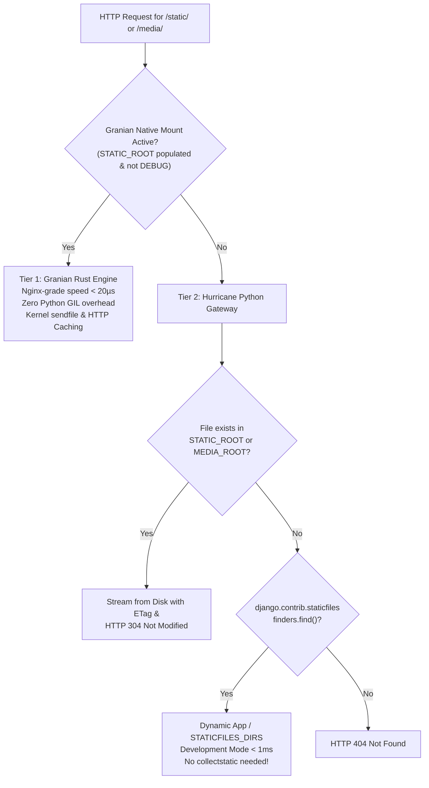

# Static & Media Files Architecture

In traditional Django Kubernetes deployments, serving static and user-uploaded media files typically requires running a separate **Nginx sidecar container** inside every pod, or configuring external reverse proxy ingress controllers with complex volume mounts.

Hurricane completely eliminates the need for Nginx sidecars by incorporating a **Three-Tier Static & Media File Architecture** powered by Granian's native Rust file streaming engine combined with Django's static finders.

---

## The Three-Tier Architecture



---

## Tier 1: Production (Granian Native Rust Engine)

### The "Nginx Replacement"
When `--static` is passed and `settings.STATIC_ROOT` exists and contains collected files:

1. Hurricane automatically configures Granian's native Rust static server:
   - `static_path_route`: Mounted at `STATIC_URL` (e.g. `"/static"`).
   - `static_path_mount`: Bound directly to the absolute filesystem path `STATIC_ROOT`.
   - `static_path_expires`: Configured with `Cache-Control: max-age=86400` (or `HURRICANE_STATIC_CACHE_EXPIRES`).
2. Requests for `/static/*` are intercepted **directly in Rust/Tokio at the socket layer**.
3. The request **never enters the Python runtime**, never acquires the Python GIL, and consumes **zero Python heap memory**.
4. Achieves throughput and latency identical to Nginx (`< 20 microseconds`).

---

## Container Image Build Recommendations for `collectstatic`

Compiling static files in containerized environments requires balancing build reproducibility, pod startup speed, and cluster security.

### 1. Always Run `collectstatic` During `docker build` (Not at Pod Boot)

Running `collectstatic` inside a Kubernetes container entrypoint or pod lifecycle hook is an anti-pattern:

- **Instant Pod Startup (<100ms vs 15–40s)**: Compiling static files during pod boot delays Kubernetes `startupProbe` and `readinessProbe` completion. During Horizontal Pod Autoscaling (HPA) traffic spikes or rolling deployments, this causes ingress delays and 502/504 errors.
- **Immutable Container Security (`readOnlyRootFilesystem`)**: Production Kubernetes security benchmarks (CIS Kubernetes Benchmark) require `securityContext.readOnlyRootFilesystem: true`. Pods running with a read-only root filesystem cannot write to `STATIC_ROOT` at runtime.
- **Concurrency & Multi-Replica Race Conditions**: When deploying 5 or 50 pod replicas simultaneously, multiple pods executing `collectstatic` concurrently against shared volumes or manifest files can corrupt the static manifest or trigger filesystem deadlocks.

---

### 2. Solving the "No Database at Build Time" Dilemma

A common hurdle during `docker build` is that Django's `settings.py` attempts to connect to a database or fails if secrets (like `SECRET_KEY` or `DATABASE_URL`) are missing. Because the production database is not accessible during CI/CD image builds, `RUN python manage.py collectstatic` can fail.

**Best Practice:** Provide dummy fallback environment variables specifically for the build step in your `Dockerfile`:

```dockerfile
# Supply safe build-time dummies so Django initializes without a live database
RUN SECRET_KEY="build-dummy-key" \
    DATABASE_URL="sqlite:///:memory:" \
    python manage.py collectstatic --noinput
```

Alternatively, configure defensive fallbacks in your `settings.py`:

```python [settings.py]
# Allow building without live database credentials
SECRET_KEY = os.environ.get("SECRET_KEY", "build-time-insecure-dummy-key")

DATABASES = {
    "default": dj_database_url.config(
        default=os.environ.get("DATABASE_URL", "sqlite:///:memory:"),
        conn_max_age=600,
    )
}
```

---

### 3. Production Multi-Stage Dockerfile Blueprint

Here is the recommended multi-stage `Dockerfile` pattern combining frontend building (Vite / Tailwind / Node), modern Python dependency resolution (`uv`), and Hurricane native static serving:

```dockerfile [Dockerfile]
# ====================================================================
# Stage 1: Build Frontend Assets (Node.js / Vite / Tailwind)
# ====================================================================
FROM node:20-alpine AS frontend-builder
WORKDIR /app
COPY package*.json ./
RUN npm ci
COPY frontend/ ./frontend/
RUN npm run build  # Generates compiled bundles in /app/static/dist/

# ====================================================================
# Stage 2: Install Python Dependencies via uv
# ====================================================================
FROM python:3.12-slim AS builder
WORKDIR /app

# Install Astral uv for ultra-fast, reproducible dependency builds
COPY --from=ghcr.io/astral-sh/uv:latest /uv /bin/uv
COPY pyproject.toml uv.lock ./
RUN uv sync --frozen --no-dev --no-install-project

# ====================================================================
# Stage 3: Final Production Runtime Image
# ====================================================================
FROM python:3.12-slim
WORKDIR /app

# Copy virtualenv and application code
COPY --from=builder /app/.venv /app/.venv
ENV PATH="/app/.venv/bin:$PATH"
COPY . /app/

# Copy compiled frontend bundles from Stage 1 into Django's static directory
COPY --from=frontend-builder /app/static/dist /app/static/dist

# Pre-compile static assets into STATIC_ROOT
RUN SECRET_KEY="build-time-dummy" \
    DATABASE_URL="sqlite:///:memory:" \
    python manage.py collectstatic --noinput --clear

# Run as non-root user for Kubernetes security
USER 10001:10001

# Start Hurricane with Granian native static serving enabled
EXPOSE 8000 8001
CMD ["python", "manage.py", "serve", "--static", "--port=8000", "--probe-port=8001"]
```

---

### 4. Cache-Busting with `ManifestStaticFilesStorage`

For optimal browser performance, configure Django's manifest storage in `settings.py`:

```python [settings.py]
STATICFILES_STORAGE = "django.contrib.staticfiles.storage.ManifestStaticFilesStorage"
# Or WhiteNoise's compressed manifest storage if you pre-compress with gzip/brotli:
# STATICFILES_STORAGE = "whitenoise.storage.CompressedManifestStaticFilesStorage"
```

- When `collectstatic` runs, it appends unique MD5 hashes to filenames (e.g. `main.bf72a1.css`).
- Granian's native Rust mount serves these with `static_path_expires=31536000` (1 year), ensuring browsers cache assets permanently without stale-cache issues.

---

### 5. When Should You Use the `--collectstatic` CLI Flag?

While compiling static files during `docker build` is standard for production, Hurricane provides the `--collectstatic` flag (and `HURRICANE_COLLECTSTATIC=True`) for specific environments:

- **Ephemeral Staging & Preview Environments**: Quick QA or feature-branch deployments where building a multi-stage Docker image per branch is not desired.
- **Local Docker Compose**: When mounting host code directories (`volumes: [.:/app]`) where `STATIC_ROOT` must be regenerated on container boot.
- **Automated CI/CD Test Runners**: Running test suites or smoke tests where a temporary static build is needed before execution.

---

## Tier 2: Development & Staging (Zero-Setup Dynamic Finders)

In local development or ephemeral staging environments, running `collectstatic` every time you edit a CSS or JavaScript file is cumbersome.

### How Dynamic Serving Works
If `STATIC_ROOT` is empty, does not exist, or `settings.DEBUG = True`:
1. Hurricane detects that native Rust mounting is not appropriate.
2. The gateway activates **Dynamic Finders Fallback**.
3. When `/static/app/style.css` is requested, Hurricane queries `django.contrib.staticfiles.finders.find()`:
   - Searches `settings.STATICFILES_DIRS` (e.g. frontend directories).
   - Searches all `INSTALLED_APPS` (e.g. `django.contrib.admin/static/admin/`, third-party packages, custom apps).
4. Files are served dynamically with proper MIME types, `ETag`, and `Last-Modified` headers.

### Live Editing Without Restarts
In development, run:
```bash
python manage.py serve --static --autoreload
```
Any edit to an asset in `STATICFILES_DIRS` or an app directory is **immediately visible upon refreshing your browser**—no server reload and no `collectstatic` execution required!

---

## Tier 3: Automated Startup Collection (`--collectstatic`)

If you run single-container deployments or staging pods where you want Granian's native Rust speed but do not want a separate Docker build step:

Pass `--collectstatic` (or set `HURRICANE_COLLECTSTATIC=True`):

```bash
python manage.py serve --static --collectstatic
```

### Execution Lifecycle
1. Hurricane executes Django's `call_command("collectstatic", interactive=False, clear=False)` during pre-flight startup before the server socket binds.
2. All static assets from all apps and `STATICFILES_DIRS` are gathered into `STATIC_ROOT`.
3. Granian detects the newly populated `STATIC_ROOT` and binds the native Rust mount.
4. The server begins handling traffic at full native Rust speed.

---

## Development with `--autoreload` and `--static-watch`

When developing modern web apps with build tools (Webpack, Vite, Tailwind CSS, esbuild) that compile frontend assets into a distribution folder:

```bash
python manage.py serve --static --collectstatic --autoreload --static-watch frontend/dist
```

### What Happens:
- `--autoreload`: Enables Granian's file system watcher.
- `--static-watch frontend/dist`: Instructs Granian to watch `frontend/dist/` in addition to Python source files.
- When your frontend tool rebuilds assets in `frontend/dist/`, Granian detects the change and triggers a fast worker reload.
- On reload, `--collectstatic` synchronizes the new bundles into `STATIC_ROOT`.

---

## Serving Media Files (`--media`)

User-uploaded media files (avatars, document attachments) stored in `settings.MEDIA_ROOT` are enabled via `--media` (or `HURRICANE_MEDIA=True`):

```bash
python manage.py serve --static --media
```

- When `MEDIA_ROOT` exists, Granian mounts `MEDIA_URL` (e.g. `/media`) directly in Rust.
- Uploaded files are served at native speed with directory traversal protection.

---

## HTTP Caching & Conditional Requests

When static or media assets are served through Hurricane's Python gateway (e.g. in dev or staging), Hurricane automatically emits production-grade HTTP caching headers:

- **`ETag`**: Deterministic file fingerprint based on inode modification time and byte length (`"{mtime}-{size}"`).
- **`Last-Modified`**: Formatted RFC 7231 GMT date.
- **`Cache-Control`**: `public, max-age=86400` in production; `no-cache` when `settings.DEBUG = True`.
- **`304 Not Modified`**: Evaluates incoming `If-None-Match` and `If-Modified-Since` headers. When matched, returns `HTTP 304` with zero payload body, saving network bandwidth.
