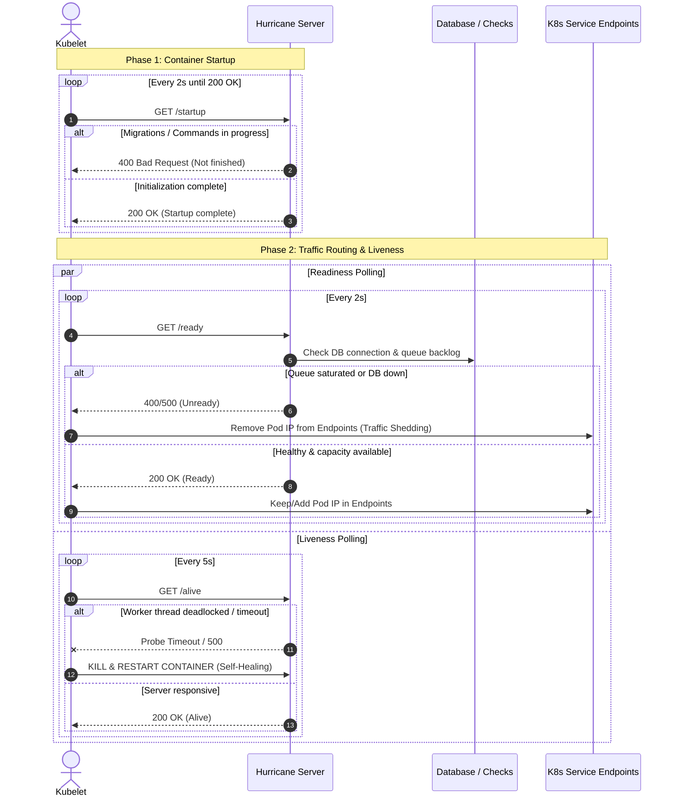
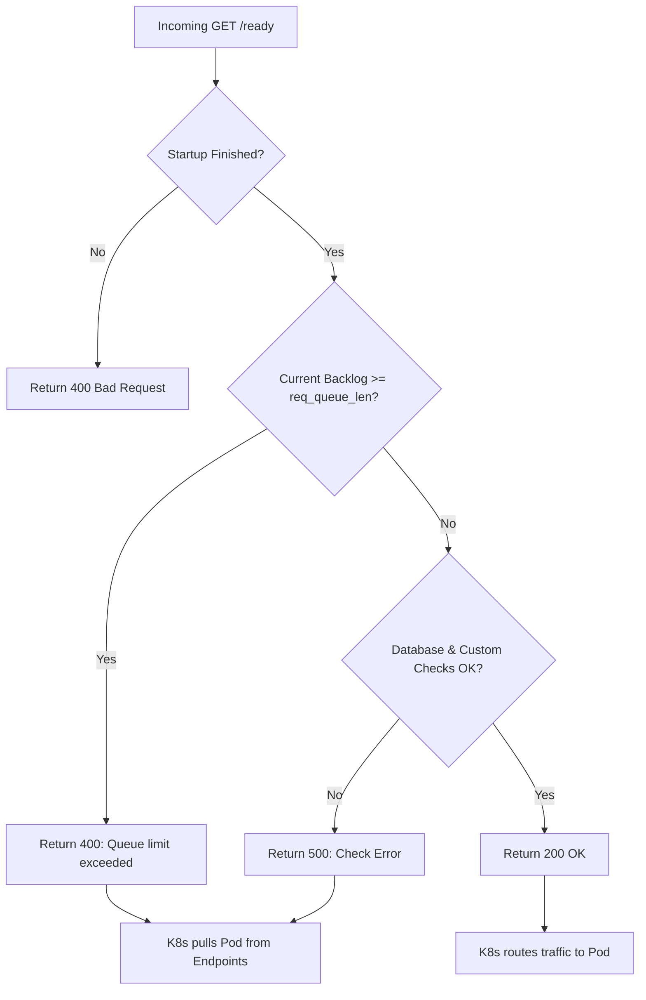
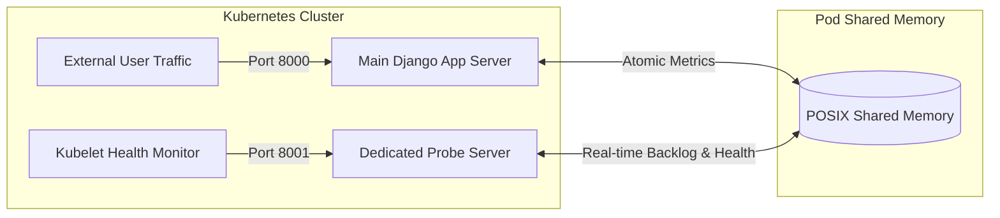

# Kubernetes Health Probes

In Kubernetes, a container that is technically "running" (process PID is alive) might actually be deadlocked, running database migrations, or drowning in a request backlog.

Kubernetes relies on three distinct probes to manage container lifecycles:
1. **Startup Probe (`/startup`)**: "Has Django finished booting and applying preflight commands?"
2. **Liveness Probe (`/alive`)**: "Are the application server and worker threads healthy, or are they deadlocked?"
3. **Readiness Probe (`/ready`)**: "Is the database reachable and does the container have capacity to accept traffic right now?"

---

## Probe Lifecycle Overview



---

## 1. Startup Probe (`/startup`)
The **Startup Probe** prevents Kubernetes from killing slow-starting containers. Without a startup probe, an aggressive liveness probe will kill Django while it is importing large dependencies or running database migrations (the classic *Kubernetes CrashLoopBackOff death spiral*).

### How Hurricane Handles Startup:
- Returns `HTTP 400 Bad Request` (`Startup is not finished yet`) while preflight tasks are executing:
  - Synchronous management commands (e.g. `--command "collectstatic --noinput"`).
  - Database schema migrations (e.g. `--check-migrations-apply`).
  - Startup system checks (see the [Developer Guide](/guides/developer-guide) for writing custom health checks).
- Returns `HTTP 200 OK` the moment Django is ready to serve requests.
- While `/startup` returns 400, Kubernetes disables the liveness probe and keeps the pod out of service endpoints.

---

## 2. Readiness Probe (`/ready`) & Congestion Shedding
The **Readiness Probe** dictates whether Kubernetes routes incoming user traffic to the pod. If a pod reports unready:
- **Zero Downtime Traffic Shedding:** Kubernetes removes the Pod's IP from the Service endpoints.
- **No Container Restart:** The container is **NOT** restarted. Existing requests finish cleanly.
- Once the pod recovers, Kubernetes immediately restores traffic.



### Real-Time Backlog Tracking:
Under Hurricane, the `--req-queue-len` parameter sets the maximum tolerable request backlog queue before a pod sheds load:
- Backlog is tracked via shared memory (`SharedMetrics`).
- When all worker threads are occupied and requests begin accumulating, `/ready` responds with `400 Bad Request`.
- Upstream ingress controllers route traffic to other pods in the replica set instead of overwhelming this instance.

---

## 3. Liveness Probe (`/alive`) & Self-Healing
The **Liveness Probe** detects catastrophic failures like Python worker thread deadlocks, infinite loops, or hung C extensions.

### How Hurricane Handles Liveness:
- Verifies that the server process is responsive and that worker threads can service requests.
- When worker threads are deadlocked, requests to `/alive` time out in Kubernetes.
- After `failureThreshold` consecutive timeouts (e.g., 2 failures), Kubernetes issues `SIGKILL` to the hung container and spawns a fresh container instance.

---

## 4. Port Isolation with `--probe-port`

In high-throughput environments, querying health probes on the same port as application traffic is dangerous: slow file uploads or heavy queries can delay probe handling and trigger false timeouts.

Hurricane solves this by allowing cluster probes to run on a dedicated secondary port:
```bash
python manage.py serve --port 8000 --probe-port 8001
```



- **Port 8000:** Handles Django application traffic, views, static assets, and media.
- **Port 8001:** Serves `/startup`, `/alive`, `/ready`, and `/metrics`. Probe responses answer in **< 2ms**, completely isolated from main thread traffic.
