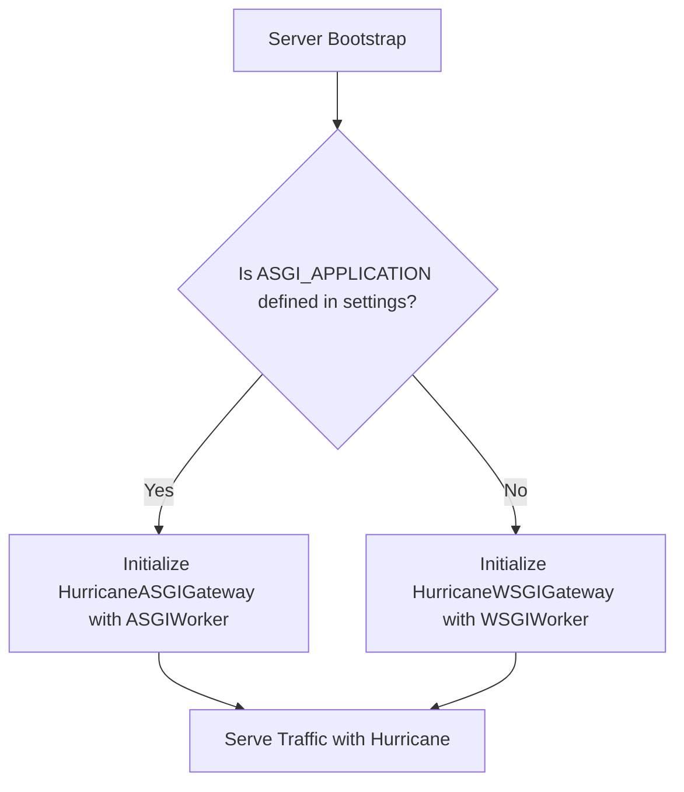

# Rust-Powered Engine

Hurricane 2.0 replaced Tornado's legacy Python asyncio event loop with a high-performance HTTP engine built directly on Rust’s **Hyper** and **Tokio** runtimes, powered by **[Granian](https://github.com/emmett-framework/granian)**.

---

## Architecture Overview

```mermaid
graph TD
    Client[Incoming Client TCP Traffic] --> Hyper[Rust Hyper HTTP Parser]
    Hyper --> Tokio[Tokio Event Loop / Worker Dispatch]

    subgraph Rust Core (Granian)
        Hyper
        Tokio
    end

    Tokio -->|Zero-Copy Dispatch| Gateway[Hurricane Base Gateway]

    subgraph Python Runtime
        Gateway --> Protection{Fast-404 & Rate Limiter}
        Protection -- Allowed --> ProtocolSplit{Protocol Detection}
        ProtocolSplit -->|WSGI_APPLICATION| WSGI[Hurricane Native Rust WSGI Worker]
        ProtocolSplit -->|ASGI_APPLICATION| ASGI[Hurricane Native Rust ASGI Worker]
        WSGI --> DjangoWSGI[Django Application Stack]
        ASGI --> DjangoASGI[Django Async / Channels Stack]
    end
```

---

## Why Rust Over Python Event Loops?

Previous versions of Hurricane used Tornado to bridge asynchronous networking with Django's synchronous WSGI layer. Under high concurrency, Python's single-threaded event loop became a bottleneck:
1. **GIL Contention:** Switching between Python coroutines and worker thread pools incurred high CPU context-switching overhead.
2. **Buffer Saturation:** Large file uploads or request storms flooded Python's memory heap before threads could process them.
3. **Event Loop Starvation:** Blocking C libraries or compute-heavy tasks temporarily froze probe responsiveness.

### With Hurricane's Rust Engine (powered by [Granian](https://github.com/emmett-framework/granian)):
- **Rust Handles the Network:** Socket connection management, TLS termination, HTTP 1.1/2 parsing, and keep-alive pools run entirely in compiled Rust without touching Python or the Global Interpreter Lock (GIL).
- **Native Thread Workers:** For WSGI applications, Hurricane manages OS worker threads directly from Rust via Granian's native worker architecture, invoking the WSGI callable only when a worker thread is free.
- **Zero-Copy File Streaming:** Static and media files are streamed with minimal memory footprint.

---

## Zero-Config WSGI & ASGI Auto-Detection

Hurricane automatically inspects your Django configuration on boot and switches to the optimal engine without requiring manual flags:



- **Classic Django Projects:** If `WSGI_APPLICATION = "myproject.wsgi.application"` is present, Hurricane boots with its multithreaded Rust WSGI engine (using Granian's `WSGIWorker`).
- **Async & Channels Projects:** If `ASGI_APPLICATION = "myproject.asgi.application"` is configured, Hurricane automatically runs with its asynchronous Rust ASGI engine (using Granian's `ASGIWorker`).
- **Manual Override:** You can force a specific execution mode via the `--mode` flag (or `MODE` in `settings.py`):
  ```bash
  python manage.py serve --mode=asgi
  ```
  *(The legacy `--interface` flag remains supported as an alias).*

---

## ⚡ Comparative Benchmarks: Hurricane 1.x (Tornado) vs. Hurricane 2.0 (Granian Rust Engine)

We pit the classic Tornado-based Hurricane against the new Rust-powered Hurricane 2.0 (using Granian) under identical high-concurrency conditions with Locust:

| Metric | Hurricane 1.x (Tornado) | Hurricane 2.0 (Granian Engine) 🦀 | Difference |
|---|---|---|---|
| **False Readiness Failures (`HTTP 400`)** | **160 flapping events** | **0 events** | **-100.0% (Eliminated!)** |
| **Peak Throughput (RPS)** | 313.3 req/s | **630.9 req/s** | **+101.4% (2x faster)** |
| **P50 Median Latency** | 130.0 ms | **66.0 ms** | **-49.2% (Half the wait)** |
| **P99 Tail Latency** | 220.0 ms | **120.0 ms** | **-45.5% faster** |
| **Probe Latency Under Load** | 170.0 ms | **94.0 ms** | **-44.7% faster** |

*Under heavy traffic, Hurricane 1.x mistook pending asyncio task counts for saturated request backlogs, triggering 160 false unready events that pulled pods out of service endpoints. Hurricane 2.0's Granian Rust engine completely eliminates false unready flaps while doubling throughput.*

::card{title="Reproduce & Run Benchmarks" icon="carbon:chart-line-data"}
Explore the reproducible benchmark suite, load scenarios, and raw result datasets at **[django-hurricane/django-hurricane-bench](https://github.com/django-hurricane/django-hurricane-bench)** on GitHub.
::
