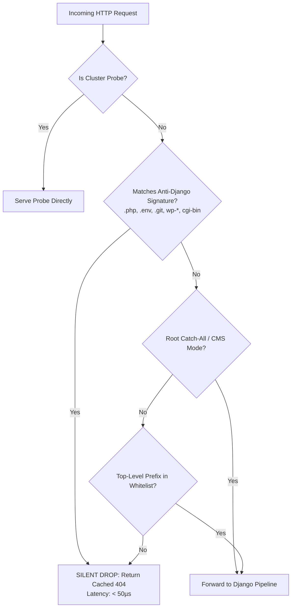
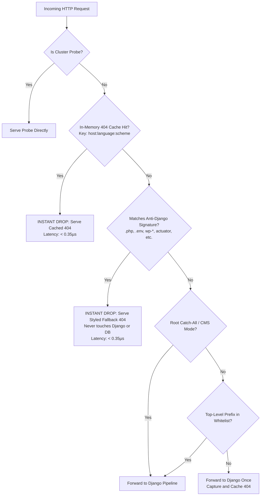

# Fast-404 Protection

Automated vulnerability scanners continuously assault Django workloads with dictionary attacks probing for PHP scripts, administrative panels, and environment leaks (`/.env`, `/wp-login.php`, `/.git/config`, `/xmlrpc.php`).

Under traditional Django setups, every attack request executes your entire middleware stack, runs session queries, and compiles a 404 error template.

Hurricane's **Fast-404 Engine** intercepts malicious and non-existent routes at the outer gateway edge in **< 50 microseconds**, completely bypassing Django's middleware pipeline, database pool, and template rendering engine.

---

## Decision Flowchart



---

## How It Works Internally

### 1. Decision Flowchart



---

## Signature Mode & Anti-Django Patterns

When Hurricane runs in `signature` mode (or in `auto` mode when a root wildcard or CMS routing is detected), it inspects incoming request URLs against a high-performance compiled regular expression targeting **non-Django vulnerabilities, scripts, tools, and frameworks**.

Because Django is a Python framework, it will never legitimately host PHP scripts, ASP.NET handler files, Java Spring Actuators, or exposed Node.js metadata. Hurricane drops these probes at Tier 2 in **under 0.35 microseconds**, shielding your database connection pool and thread workers from being exhausted by botnets.

### Built-in Signature Pattern Categories

| Category | Targets & Frameworks | Example Probes Blocked |
| :--- | :--- | :--- |
| **Non-Python Script & Binary Extensions** | PHP, ASP.NET, Java Servlets/JSP, Perl/CGI | `.php`, `.asp`, `.aspx`, `.jsp`, `.jspx`, `.cgi`, `.pl`, `.action`, `.do`, `.ashx`, `.asmx`, `.axd`, `.faces`, `.dll`, `.exe` |
| **Sensitive Config & Secrets Leaks** | Environment, VCS, Cloud & Container configs | `/.env*`, `/.git/*`, `/.svn/*`, `/.hg/*`, `/.aws/*`, `/.docker/*`, `/.htaccess`, `/.DS_Store`, `/.bash_history`, `web.config`, `docker-compose.yml`, `database.yml` |
| **Database Backups & Dumps** | Raw SQL exports and compressed dumps | `dump.sql`, `backup.sql.gz`, `database.sql`, `db.sql`, `users.sql` |
| **Node.js & Ruby on Rails** | Package manifests, lockfiles, Rails consoles | `package.json`, `package-lock.json`, `yarn.lock`, `npm-debug.log`, `/rails/info/*`, `/rails/mailers/*` |
| **PHP, WordPress & CMS Targets** | WordPress core, plugins, REST API, phpMyAdmin | `/wp-admin/*`, `/wp-content/*`, `/wp-includes/*`, `/wp-json/wp/v2/users`, `/xmlrpc.php`, `wp-config.php`, `/wordpress/*`, `/phpmyadmin/*`, `/pma/*`, `/adminer.php` |
| **PHP Web Shells & Backdoors** | Known exploit shells & discovery scripts | `phpinfo.php`, `info.php`, `test.php`, `shell.php`, `c99.php`, `r57.php`, `wso.php`, `alfa.php`, `eval-stdin.php` |
| **PHP Framework Exploits** | Laravel, Drupal, Joomla, Magento | `/_ignition/execute-solution`, `/_ignition/health-check`, `/telescope/*`, `/horizon/*`, `/core/install.php`, `/update.php`, `/cron.php`, `/administrator/index.php`, `/vendor/phpunit/*` |
| **Java & Spring Boot Actuators** | Spring Boot Actuator inspection endpoints | `/actuator`, `/actuator/env`, `/actuator/heapdump`, `/actuator/health`, `/actuator/metrics`, `/actuator/logfile`, `/actuator/gateway` |
| **Enterprise App Servers & Consoles** | Tomcat, JBoss, WebLogic consoles | `/manager/html`, `/host-manager/html`, `/jmx-console/*`, `/web-console/*`, `/invoker/JMXInvokerServlet` |
| **Infrastructure & Search Engines** | Search clusters, GIS servers, Exchange | `/solr/admin/*`, `/geoserver/web/*`, `/autodiscover/*`, `/cgi-bin/*` |

### Multilingual & Internationalized (`i18n`) Support
All anti-Django patterns use unanchored path boundaries `(?:^|/)`. This guarantees that attacks targeting internationalized Django applications are caught regardless of whether they hit the root URL or a language prefix (e.g. `/wp-admin/`, `/de/wp-admin/`, `/en/.env`, or `/fr/xmlrpc.php`).

### Zero False Positives for Legitimate Django Endpoints
The pattern definitions strictly avoid intercepting legitimate Django features:
- **Django Admin (`/admin/`)**: Fully functional and never blocked.
- **SSL / ACME Challenges (`/.well-known/acme-challenge/`)**: Allowed without interference for automated Let's Encrypt certificate renewals.
- **SSO & OpenID Discovery (`/.well-known/openid-configuration`)**: Fully preserved for OAuth / OIDC enterprise authentication.
- **REST APIs & Static Assets (`/api/*`, `/static/*`, `/media/*`)**: Allowed cleanly.

---

## On-Demand Dynamic Caching Architecture

Unlike traditional web servers or naive 404 handlers that execute synthetic requests at startup, Hurricane uses a **Lazy Cache-on-First-404** architecture.

### Why Synthetic Pre-Rendering is Avoided
Pre-rendering 404 pages during server bootstrap creates fragile race conditions in containerized environments:
1. Databases might still be running migrations or connection pools may be warming up.
2. Synthetic `RequestFactory` objects lack live session backends, tenant context, and routing matches (`request.resolver_match`), causing CMS plugins or template tags to raise exceptions.
3. Multi-site and multilingual setups require different templates per `Host` header and `Accept-Language`.

### How On-Demand Caching Operates

1. **Zero-Delay Startup (`0ms`)**:
   Server boot requires zero database queries and zero template rendering. The gateway initializes instantly with a styled HTML5 fallback response in memory.

2. **First 404 Fallthrough**:
   When an unknown prefix or legitimate 404 route is hit for the first time:
   - The request falls through to Django naturally.
   - Django executes its complete, authentic middleware pipeline and your custom `handler404` view with real database connections, language resolution, site detection, and template engines (such as **Django CMS**, **Wagtail**, or **django-sekizai**).
   - Hurricane’s gateway captures the rendered 404 status, response headers, and HTML body on its way back to the client.

3. **Per-Host & Per-Language Cache Storage**:
   Hurricane caches the rendered response in an in-memory LRU cache keyed by:
   ```text
   f"{host}:{language}:{scheme}"
   ```
   - **`host`**: Guarantees distinct 404 templates for multi-tenant and multi-site deployments (e.g. `shop.example.com` vs `portal.example.com`).
   - **`language`**: Automatically serves language-specific 404 templates (e.g. German, English, French).
   - **`scheme`**: Preserves protocol-appropriate asset links (`http` vs `https`).

4. **Sub-Microsecond Subsequent Drops**:
   Once cached, any matching route—including automated signature scanner attacks—is served directly from memory in **0.35 microseconds** without consuming thread pool capacity or hitting database pools.

---

## Architectural Recommendations for 404 Handlers

To ensure your custom 404 view runs smoothly with Fast-404 caching:

1. **Use `.filter().first()` for Model Lookups**:
   If your 404 handler fetches settings or site objects based on language (e.g. `PageSetting.objects.get(language_code=language)`), prefer:
   ```python
   page_setting = PageSetting.objects.filter(language_code=language).first() or PageSetting.objects.first()
   ```
   This prevents unexpected `DoesNotExist` exceptions when scanner requests arrive with unconfigured language codes.

2. **Avoid Auth Redirects in 404 Views**:
   Do not wrap global 404 handlers with `@login_required` or redirect invalid paths to `/login/`. Fast-404 relies on the response having status `404` to populate its cache. Returning a `302` prevents Fast-404 from caching the response.

3. **Let Signature Attacks Drop at the Edge**:
   Leave `FAST_404 = "auto"` enabled. Malicious bot storms scanning for `.env` or `wp-admin` will be stopped at the outer edge, keeping your Django application resilient under heavy traffic.
