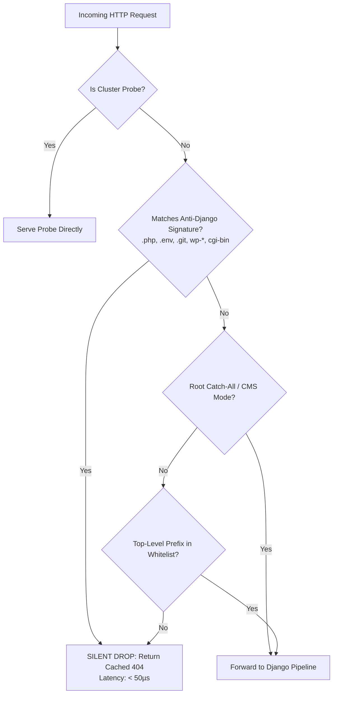

# Fast-404 Protection

Automated vulnerability scanners continuously assault Django workloads with dictionary attacks probing for PHP scripts, administrative panels, and environment leaks (`/.env`, `/wp-login.php`, `/.git/config`, `/xmlrpc.php`).

Under traditional Django setups, every attack request executes your entire middleware stack, runs session queries, and compiles a 404 error template.

Hurricane's **Fast-404 Engine** intercepts malicious and non-existent routes at the outer gateway edge in **< 50 microseconds**, completely bypassing Django's middleware pipeline, database pool, and template rendering engine.

---

## Decision Flowchart

---

## How It Works Internally

### 1. Predefined Anti-Django Signature Matching
Hurricane ships with an optimized regular expression containing 31+ attack patterns that Django would never legitimately serve:
- **Non-Python Script Extensions:** `.php[0-9]?`, `.asp[x]?`, `.jsp[x]?`, `.cgi`, `.pl`, `.action`, `.do`.
- **Sensitive Config & Secrets:** `/.env*`, `/.git/*`, `/.svn/*`, `/.aws/*`, `/.docker/*`, `/web.config`.
- **Common Scanner Targets:** `/wp-*`, `/wordpress`, `/xmlrpc.php`, `/phpmyadmin`, `/pma`, `/admin.php`, `/eval-stdin.php`.
- **Remote Code Execution Probes:** `/cgi-bin/*`, `/actuator/*`, `/solr/*`, `/vendor/phpunit/*`.

### 2. Prefix Whitelisting
For standard Django applications, Hurricane walks `urlpatterns` recursively at startup to extract all valid top-level path segments (e.g. `{"", "admin", "api", "accounts", "media", "static"}`). Any request with an unknown top-level segment (e.g., `/unknown-exploit/path`) is dropped immediately.

### 3. CMS & Dynamic Route Auto-Detection
If your Django application uses dynamic database-driven routing with a root catch-all (like **Wagtail**, **django-cms**, or `path("<path:slug>", ...)`):
- Hurricane detects the root wildcard on boot.
- Hurricane automatically switches to **Signature-Only Mode**.
- Legitimate CMS page slugs (e.g. `/company/about-us/`) are forwarded to Django normally, while attack probes (`/.env`, `/wp-login.php`) remain blocked.

### 4. Bootstrap 404 Pre-Rendering
To ensure total visual fidelity with zero runtime cost, Hurricane renders your site's configured `handler404` (custom or default) once during server bootstrap using a synthetic request. The rendered HTML `bytes` and headers are cached in memory for zero-allocation serving.

### 5. Silent Operation (Zero Log Spam)
During an attack of 50,000 requests/second, writing log lines can crash log forwarders and exhaust node disk space. Hurricane drops Fast-404 requests **silently** without writing access logs, while updating Prometheus metrics (`RequestCounterMetric`) for Grafana observability.
