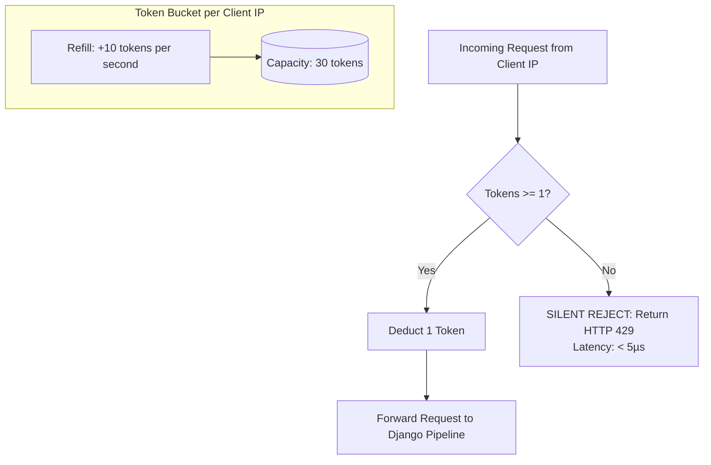

# Request Rate Limiting

Malicious scripts, scrapers, and volumetric Denial-of-Service (DoS) floods can quickly overwhelm Django worker threads and exhaust database connection pools.

Hurricane features a built-in, in-memory **Token Bucket Rate Limiter** enabled by default that enforces traffic quotas at the edge before requests reach Django.

---

## How the Token Bucket Works



### Why Default to 10 req/s with a Burst of 30?
A naive hard limit of 10 requests/second will break modern web browsers: loading an average Django web page triggers 15 to 25 parallel requests for CSS, JavaScript, fonts, and assets in under 300ms.
- **Sustained Rate (10 req/s):** The steady-state consumption speed.
- **Burst Allowance (30 tokens):** Allows legitimate browser page-load storms, tab refreshes, and corporate office NATs without triggering false positives.
- If a flood bot fires 100 requests in 1 second, the first 30 succeed and the remaining 70 are dropped instantly with `429 Too Many Requests`.

---

## Kubernetes Client IP Extraction

In Kubernetes, traffic routes through cloud load balancers and ingress controllers. If a web server inspects the raw TCP socket address (`REMOTE_ADDR`), every request appears to originate from the internal Ingress Pod IP, locking out all users globally within seconds.

Hurricane safely resolves the real client IP using trusted forwarding headers:
1. **`X-Forwarded-For`:** Extracts the leftmost non-proxy IP from comma-separated proxy chains:
   ```text
   X-Forwarded-For: 203.0.113.195, 10.42.0.1, 10.42.0.15
                    └─ Client IP ──┘
   ```
2. **`X-Real-IP`:** Fallback if `X-Forwarded-For` is missing.
3. **`REMOTE_ADDR`:** Final fallback for local development.

---

## Silent Operation Policy

During a flood attack, writing access logs for thousands of dropped requests creates a secondary Denial-of-Service on disk I/O, stdout buffers, and log forwarders (Promtail, Fluentbit).

Hurricane enforces a strict **Silent Drop Policy**:
- **Startup Audit Log:** Prints exactly one structured configuration log on boot:
  ```text
  2026-10-21 12:00:00 INFO hurricane.server.limiter Rate limiter active: 10.0 req/s (burst: 30) [IP Header: X-Forwarded-For]
  ```
- **Zero Log Pollution:** Requests dropped with `429 Too Many Requests` produce **zero log lines**.
- **Probe Exemption:** Kubernetes cluster probes (`/alive`, `/ready`, `/startup`, `/metrics`) are checked *before* rate limits and are **never throttled**.
