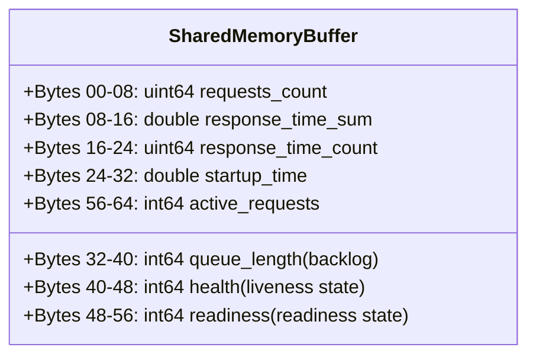

# Shared Memory & Prometheus Metrics

When running multi-process application servers (e.g. separate probe servers on port 8001 or multiple worker threads), tracking real-time metrics across process boundaries without database locking or inter-process communication (IPC) bottlenecks is a difficult challenge.

Hurricane solves this by allocating an atomic **POSIX Shared Memory Buffer** (`SharedMetrics`) directly in the OS virtual memory space.

---

## Binary Buffer Memory Layout

Hurricane maps a 72-byte fixed-size binary buffer in shared memory (`/dev/shm`):

### Why Shared Memory?
1. **Sub-Microsecond Latency:** Reading and updating counters uses direct memory pointers (`struct.pack_into` and `struct.unpack_from`).
2. **Zero IPC Latency:** The probe server on port 8001 can check the worker backlog on port 8000 in **< 1 microsecond** without opening sockets or making RPC calls.
3. **No Garbage Collection Pressure:** Fixed-size binary struct allocations produce 0 Python object garbage.

---

## Prometheus Exposition (`/metrics`)

Hurricane includes a native Prometheus exporter available on the `/metrics` endpoint (or on the probe port if separated):

### Default Exposed Metrics:
- **`request_counter`:** Monotonically increasing counter of all requests received.
- **`response_time_average`:** Real-time exponential moving average response time.
- **`request_queue_length`:** Current worker backlog queue depth.
- **Python Runtime Metrics:** Garbage collection collections (`python_gc_objects_collected_total`), process virtual memory, CPU times, and open file descriptors.

### Custom Metrics Registry:
Developers can register application-specific custom metrics using Hurricane's metric classes:
- **`CounterMetric`**: Incrementing event counters.
- **`CalculatedMetric`**: Dynamically computed gauge values evaluated at scrape time.
