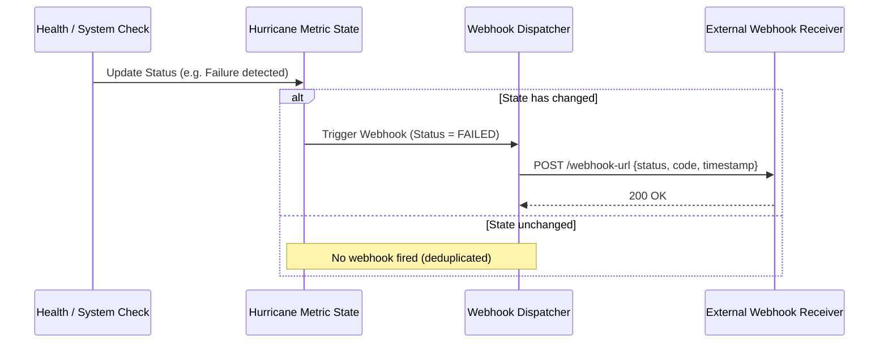

# Lifecycle Webhooks

In enterprise Kubernetes environments, notifying external observability platforms, incident response systems, or deployment pipelines when a pod changes health state is essential for fast recovery.

Hurricane includes an asynchronous **Webhook Dispatcher** that triggers HTTP notifications when probe states transition.

---

## Webhook Trigger Flow



---

## Built-in Webhook Types

Hurricane defines three standard webhook dispatchers corresponding to Kubernetes probe states:

1. **`StartupWebhook`**: Dispatched once preflight management commands and migrations finish.
2. **`LivenessWebhook`**: Dispatched if worker threads deadlock or recover.
3. **`ReadinessWebhook`**: Dispatched when a pod transitions between ready and unready (e.g. database down, congestion limit exceeded).

### Payload Structure:
When triggered, Hurricane sends an HTTP POST with a structured JSON body:
```json
{
  "code": "readiness",
  "status": "failed",
  "timestamp": 1792575000,
  "data": {
    "reason": "Request queue limit exceeded"
  }
}
```

### Configuration:
Enable webhook dispatching by specifying `--webhook-url` or setting `HURRICANE_WEBHOOK_URL`:
```bash
python manage.py serve --webhook-url=https://alerts.mycompany.com/k8s/hooks/
```
