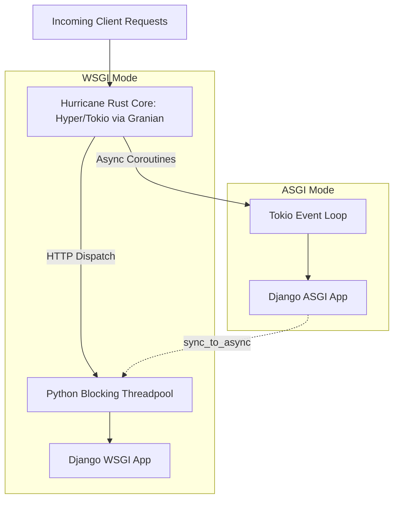

# ASGI vs. WSGI Architecture

Django Hurricane supports both **WSGI** (Web Server Gateway Interface) and **ASGI** (Asynchronous Server Gateway Interface) runtimes through its high-performance Rust engine, powered by **[Granian](https://github.com/emmett-framework/granian)**.

Understanding the fundamental differences between these two execution models ensures optimal concurrency, resource utilization, and health monitoring in production.

---

## Architecture Comparison

| Feature | WSGI (`--mode wsgi`) | ASGI (`--mode asgi`) |
|---|---|---|
| **Paradigm** | Synchronous, blocking request-per-thread | Asynchronous, non-blocking coroutines |
| **Concurrency Engine** | Python worker threadpool (`blocking_threads`) | Rust Tokio event loop (`runtime_threads`) + threadpool |
| **I/O Handling** | Synchronous socket polling under GIL | Multi-core work-stealing async scheduler in Rust |
| **WebSockets & SSE** | ❌ Not supported | ✅ Native support |
| **Async Views (`async def`)** | ❌ Executed synchronously via adapter | ✅ Executed natively on event loop |
| **Readiness Probing** | Request queue depth (`--req-queue-len`) | Event Loop Lag Tracking (`HURRICANE_LOOP_LAG_THRESHOLD`) |

---

## Hurricane Concurrency Models

Hurricane manages concurrency through three distinct layers (powered by Granian's Rust runtime):



### 1. The WSGI Concurrency Model
In WSGI mode, Django code is strictly synchronous:
- Each incoming HTTP connection is dispatched to an available worker thread in Hurricane's worker thread pool (`blocking_threads`).
- While a request waits on a database query, file I/O, or an external API response, that worker thread is completely blocked.
- **Concurrency Capacity:** Strictly bounded by the thread pool: **Max In-Flight Requests = `blocking_threads`**. Any additional requests exceeding this pool queue in the socket backlog.

### 2. The ASGI Concurrency Model
In ASGI mode, requests are received and driven by the multi-threaded **Tokio async runtime**:
- Asynchronous views (`async def`) and non-blocking I/O operations yield control to the event loop, multiplexing thousands of concurrent connections on a few OS threads.
- In ASGI mode, `--runtime-threads` automatically defaults to the number of available CPU cores (up to 16), allowing Hurricane's Rust runtime to schedule async tasks across all physical cores.
- When an ASGI view invokes synchronous Django models or legacy sync functions, Django offloads the work to `blocking_threads` via `sync_to_async`.

---

## Readiness Probing: Queue Backlog vs. Loop Lag

Because the execution models differ fundamentally, Hurricane monitors health and enforces Kubernetes readiness shedding differently depending on the active mode:

### WSGI: Threadpool Backlog (`--req-queue-len`)
In WSGI, each concurrent request consumes a thread. If all worker threads are busy, incoming requests queue in the socket backlog. 

Hurricane tracks this backlog atomically in POSIX shared memory (`/dev/shm`). When backlog exceeds `--req-queue-len` (default: 10), `/ready` returns **HTTP 400 Bad Request**, signaling Kubernetes to temporarily withdraw the pod from load-balanced endpoints until worker threads free up.

### ASGI: Event Loop Lag Tracking
In ASGI, active coroutines are non-blocking; thousands of concurrent WebSocket connections or async HTTP requests can sit idle on a single thread with zero queue backlog. Subtracting thread counts from coroutines would create false-positive probe failures.

Instead, Hurricane ASGI uses an **Event Loop Lag Tracker**:
- An internal monitor evaluates event loop scheduling responsiveness every 50ms (`asyncio.sleep(0.05)`).
- When the event loop is responsive, scheduling latency (lag) remains near 0ms.
- If synchronous CPU-bound operations or saturated async tasks starve the event loop, lag rises.
- If event loop lag exceeds `HURRICANE_LOOP_LAG_THRESHOLD` (default: 200ms), `/ready` returns **HTTP 400**, shedding traffic until the loop recovers.

::alert{type="warning"}
The `--req-queue-len` option is strictly a WSGI parameter. If explicitly passed when running in ASGI mode, Hurricane logs a startup warning indicating that `--req-queue-len` is ignored in favor of Event Loop Lag Tracking.
::

---

## When to Choose WSGI vs. ASGI

::feature-boxes
:::feature-box{tag="Synchronous" title="Choose WSGI When:"}
- Your application consists of standard, synchronous Django views and Django REST Framework endpoints.
- You rely entirely on traditional relational database queries without async ORM drivers.
- Maximum single-request CPU performance for synchronous code execution is required.
- You have no WebSockets, SSE, or streaming response requirements.
:::
:::feature-box{tag="Asynchronous" title="Choose ASGI When:"}
- Your application uses **WebSockets** (e.g. Django Channels, chat, real-time dashboards).
- You utilize **Server-Sent Events (SSE)** or long-lived streaming responses.
- Your views make concurrent non-blocking outbound HTTP calls via `httpx` or `aiohttp`.
- High connection concurrency with low individual request activity is expected.
:::
::

### Benchmark Insights & Architecture Recommendations

Performance evaluations from our benchmark suite at **[django-hurricane/django-hurricane-bench](https://github.com/django-hurricane/django-hurricane-bench)** reveal distinct operational trade-offs between modes:

- **WSGI Concurrency Sizing:** In WSGI mode, response times stack when user concurrency exceeds the available `blocking_threads` count because requests must wait in the socket queue. For synchronous Django workloads, size `--workers` to match your container's CPU quota plus expected concurrent I/O waits.
- **ASGI High-Throughput Scaling:** Under heavy concurrency (80+ users), Hurricane's ASGI multi-core Tokio runtime achieves **630+ RPS** with sub-100ms P50 latency and **zero false-unready probe flaps**, outperforming classic Python asyncio servers by over 100%.
- **Recommendation:** If your workload is primarily synchronous ORM queries, stick with WSGI for simplicity and raw single-thread speed. If you have async views, WebSockets, or outbound microservice calls, Hurricane's ASGI mode leverages the multi-core Tokio scheduler to maximize throughput without thread exhaustion.

> 📊 **Explore the Data:** Review reproducible load scenarios, Locust scripts, and raw JSON benchmarks at **[django-hurricane-bench](https://github.com/django-hurricane/django-hurricane-bench)** on GitHub.

---

## Common ASGI Pitfalls in Django

### 1. Synchronous ORM Calls in Async Views
Calling synchronous ORM queries directly inside an `async def` view triggers Django's `SynchronousOnlyOperation` exception:

```python [views.py - Incorrect]
async def my_view(request):
    # Raises SynchronousOnlyOperation!
    users = User.objects.all()
    return JsonResponse({"count": users.count()})
```

**Correct Approach:** Wrap synchronous calls with `sync_to_async` or use Django's native asynchronous querysets:

```python [views.py - Correct]
async def my_view(request):
    # Using async iteration or sync_to_async
    users_count = await User.objects.acount()
    return JsonResponse({"count": users_count})
```

### 2. Database Connection Pooling Across Coroutines
In synchronous WSGI, database connections are managed per thread (`django.db.connection`). In ASGI, multiple coroutines interleaving on the same thread cannot share the same synchronous database connection without synchronization. Always rely on Django's asynchronous ORM interfaces (`.aget()`, `.acount()`, `.aexists()`) or explicitly wrap blocks with `sync_to_async(..., thread_sensitive=True)`.
