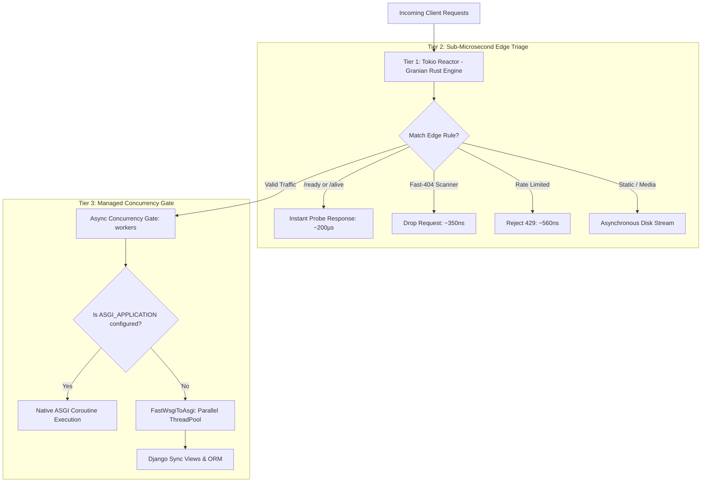

# Unified Asynchronous Front-Door Architecture

Django Hurricane executes all traffic through a **Unified Asynchronous Front-Door** powered by **[Granian](https://github.com/emmett-framework/granian)** and Rust's **Tokio** runtime.

Rather than forcing developers to configure fragile transport switches, Hurricane automatically provides high-performance edge shielding on the network perimeter and auto-dispatches to your Django application whether it is written with asynchronous views (`asgi.py`) or traditional synchronous views (`wsgi.py`).

---

## Architectural Comparison

| Feature | Synchronous Workloads (`wsgi.py`) | Native Asynchronous (`asgi.py`) |
|---|---|---|
| **Intake Reactor** | Tokio event loop (Rust Hyper) | Tokio event loop (Rust Hyper) |
| **Edge Triage (Tier 2)** | Sub-microsecond (Fast-404, 429, Probes) | Sub-microsecond (Fast-404, 429, Probes) |
| **Execution Dispatch** | Parallel `ThreadPoolExecutor` (`FastWsgiToAsgi`) | Native async coroutines on Tokio loop |
| **WebSockets & SSE** | Handled via sync views or Channels | ✅ Native support |
| **ORM Query Handling** | Multi-threaded parallel DB connections | Async ORM (`.aget()`, `.acount()`) |
| **Readiness Probing** | Concurrency Gate Backlog (`--req-queue-len`) | Event Loop Lag Tracking + Backlog |

---

## The Three-Tier Pipeline

Hurricane organizes request processing into three distinct tiers:



### Tier 1: Tokio Non-Blocking Reactor
Granian's compiled Rust core accepts thousands of incoming TCP sockets non-blockingly, parsing HTTP headers and delegating requests to Python coroutines without consuming OS threads.

### Tier 2: Sub-Microsecond Edge Triage
Before any request touches Django middleware, view routing, or database connection pools:
- **Fast-404 Shield:** Intercepts automated scanner attacks (e.g. `/.env`, `/wp-login.php`) in **~0.35 µs**.
- **Token-Bucket Rate Limiter:** Evaluates client IP quotas and sheds floods in **~0.56 µs**.
- **Kubernetes Probes:** Answers `/ready`, `/alive`, and `/metrics` in microseconds.
- **Static & Media Files:** Streamed directly from disk without blocking application threads.

Scanners, bots, and probes exit immediately without touching worker threads or database pools.

### Tier 3: Managed Concurrency Gate
Legitimate application traffic passes into an asynchronous concurrency gate (`AsyncConcurrencyGate`) sized to your `--workers` limit:
- **Native ASGI:** Views defined with `async def` run directly as coroutines on the Tokio event loop.
- **Synchronous WSGI:** Traditional views are dispatched to a multi-threaded `ThreadPoolExecutor` using Hurricane's custom `FastWsgiToAsgi` adapter. Unlike Django's default `asgiref` (which serializes queries to a single thread), `FastWsgiToAsgi` runs queries across multiple worker threads in parallel.

---

## Readiness Probing: Accurate Soft-Limit Shedding

In pure WSGI servers, request backlogs are hidden inside operating system socket buffers, making it impossible to detect application overload accurately.

With Hurricane's Unified Asynchronous Front-Door:
- **Backlog Tracking (`--req-queue-len`):** Hurricane monitors the exact count of legitimate requests waiting in Tier 3 for a worker slot. If waiting requests exceed `--req-queue-len` (default: `workers * 2`), `/ready` immediately returns **HTTP 400 Bad Request**.
- **Load Shedding without Drops:** When `/ready` returns 400, Kubernetes Ingress ceases routing new users to this pod. The requests already in the queue are completed normally by worker threads without connection resets. Once the queue drains, `/ready` returns 200 OK.
- **Event Loop Lag Tracking:** For native async workloads, Hurricane also monitors scheduling responsiveness. If CPU-bound tasks starve the event loop beyond `HURRICANE_LOOP_LAG_THRESHOLD` (default: 200ms), `/ready` sheds traffic.

### Benchmark Insights & Architecture Recommendations

Performance evaluations from our benchmark suite at **[django-hurricane/django-hurricane-bench](https://github.com/django-hurricane/django-hurricane-bench)** reveal distinct operational trade-offs between modes:

- **WSGI Concurrency Sizing:** In WSGI mode, response times stack when user concurrency exceeds the available `blocking_threads` count because requests must wait in the socket queue. For synchronous Django workloads, size `--workers` to match your container's CPU quota plus expected concurrent I/O waits.
- **ASGI High-Throughput Scaling:** Under heavy concurrency (80+ users), Hurricane's ASGI multi-core Tokio runtime achieves **630+ RPS** with sub-100ms P50 latency and **zero false-unready probe flaps**, outperforming classic Python asyncio servers by over 100%.
- **Recommendation:** If your workload is primarily synchronous ORM queries, stick with WSGI for simplicity and raw single-thread speed. If you have async views, WebSockets, or outbound microservice calls, Hurricane's ASGI mode leverages the multi-core Tokio scheduler to maximize throughput without thread exhaustion.

> 📊 **Explore the Data:** Review reproducible load scenarios, Locust scripts, and raw JSON benchmarks at **[django-hurricane-bench](https://github.com/django-hurricane/django-hurricane-bench)** on GitHub.

---

## Common ASGI Pitfalls in Django

### 1. Synchronous ORM Calls in Async Views
Calling synchronous ORM queries directly inside an `async def` view triggers Django's `SynchronousOnlyOperation` exception:

```python [views.py - Incorrect]
async def my_view(request):
    # Raises SynchronousOnlyOperation!
    users = User.objects.all()
    return JsonResponse({"count": users.count()})
```

**Correct Approach:** Wrap synchronous calls with `sync_to_async` or use Django's native asynchronous querysets:

```python [views.py - Correct]
async def my_view(request):
    # Using async iteration or sync_to_async
    users_count = await User.objects.acount()
    return JsonResponse({"count": users_count})
```

### 2. Database Connection Pooling Across Coroutines
In synchronous WSGI, database connections are managed per thread (`django.db.connection`). In ASGI, multiple coroutines interleaving on the same thread cannot share the same synchronous database connection without synchronization. Always rely on Django's asynchronous ORM interfaces (`.aget()`, `.acount()`, `.aexists()`) or explicitly wrap blocks with `sync_to_async(..., thread_sensitive=True)`.
