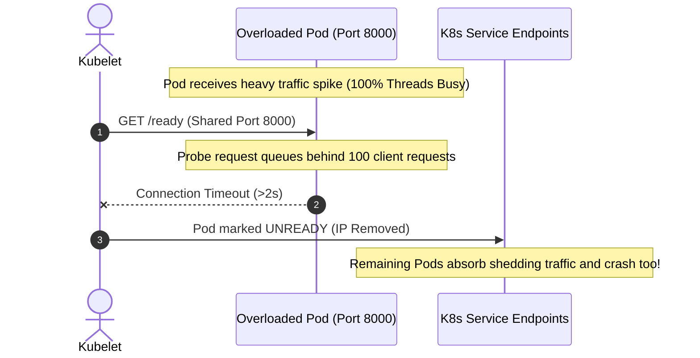

# Kubernetes Scaling & Pod Constraints

Benchmark results from the **[Django Hurricane Benchmark Suite](https://github.com/django-hurricane/django-hurricane-bench)** reveal that server architecture decisions that look great on bare-metal hardware behave fundamentally differently inside containerized **Kubernetes Pods**.

In cloud-native environments, microservices typically run in lightweight, horizontally autoscaled pods with strict resource quotas (e.g. `1–2 vCPUs`, `1Gi–2Gi` RAM). Understanding how thread limits, socket multiplexing, and probe health interact under these constraints is critical for production resilience.

---

## 1. The Small Pod Constraint (1–2 vCPUs) & Thread Starvation

### The Bare-Metal Illusion
On an 8- to 16-core dedicated bare-metal server, Hurricane's auto-thread calculation `min(32, CPU + 4)` provisions **12 to 20 worker threads**. This abundant threadpool depth easily masks blocking I/O delays; if 4 requests block on an external API or database lock, 16 threads remain available to service incoming traffic.

### The Cloud-Native Container Reality
In modern Kubernetes clusters, standard best practices dictate running smaller, horizontally scalable Pods (1–2 vCPUs) governed by a Horizontal Pod Autoscaler (HPA):

```mermaid
graph TD
    subgraph 1 vCPU Pod: WSGI Threadpool (5 Threads)
        T1[Thread 1: Blocked on Stripe API]
        T2[Thread 2: Blocked on Auth Service]
        T3[Thread 3: Blocked on Slow DB Lock]
        T4[Thread 4: Blocked on Inventory API]
        T5[Thread 5: Blocked on S3 Upload]
        Queue[Socket Listen Queue: 50+ Inbound Requests Overflowing!]
    end
```

Under WSGI with a 1-vCPU limit:
- The formula `min(32, 1 + 4)` allocates **only 5 worker threads**.
- If just 5 concurrent requests hit a third-party payment gateway, an external auth provider, or an upstream microservice with a 200ms latency spike, **100% of the pod's worker capacity is instantly deadlocked**.
- Any subsequent incoming requests (including fast health probes) queue in the TCP listen backlog. P95 latency explodes from 200ms to over 3000ms within seconds.

---

## 2. The ASGI Socket Multiplexing Advantage in Small Pods

Under ASGI, Hurricane decouples incoming network sockets from OS worker threads through [Granian](https://github.com/emmett-framework/granian)'s multi-threaded **Tokio Rust event loop**:

| Pod Resource Quota | WSGI Concurrent In-Flight Sockets | ASGI Concurrent In-Flight Sockets | Architectural Limit |
|---|---|---|---|
| **1 vCPU / 1 GiB RAM** | **5 concurrent requests** | **Thousands of concurrent sockets** | WSGI bounded by threadpool; ASGI bounded by OS file descriptors. |
| **2 vCPUs / 2 GiB RAM** | **6 concurrent requests** | **Thousands of concurrent sockets** | Tokio event loop multiplexes connections without consuming OS threads. |
| **4 vCPUs / 4 GiB RAM** | **8 concurrent requests** | **Thousands of concurrent sockets** | Non-blocking coroutines yield during external I/O waits. |

### Empirical Evidence from the Benchmark Suite
In the benchmark's API Gateway scatter-gather fan-out (`/api/gateway/aggregate`) and external API fetch (`/external/fetch`) workloads:
- **WSGI under step load:** When concurrent users exceeded the available thread count, tail latency ($p95$) spiked to **5600 ms** because requests were forced to wait in the OS listen backlog.
- **ASGI under step load:** Asynchronous coroutines yielded the Tokio event loop during socket waits (`httpx`), keeping tail latencies flat and eliminating the thread-starvation deadlocks that severely degrade WSGI.

---

## 3. Preventing Kubernetes Health Probe Flapping Under Load

In high-concurrency Kubernetes clusters, server overload often causes the dreaded **Probe Flapping Death Spiral**:



### The Hurricane Solution:
1. **Dedicated Secondary Probe Port (`--probe-port 8001`)**:
   By binding `/ready`, `/alive`, and `/metrics` to port `8001`, cluster health probes never queue behind heavy client payloads, large file uploads, or slow view responses on port `8000`.
2. **Shared-Memory Traffic Shedding (`/ready`)**:
   Hurricane continuously tracks request queue length via lock-free POSIX shared memory (`SharedMetrics`). When the queue depth exceeds `--req-queue-len`:
   - `/ready` immediately returns `400 Bad Request` in microseconds.
   - Kubernetes gracefully stops sending new Ingress traffic to the pod.
   - The container **never restarts**, and existing in-flight requests finish cleanly.
   - Once the queue clears, `/ready` returns `200 OK`, and traffic resumes instantly without container restart overhead.

---

## 4. Horizontal Pod Autoscaling (HPA) Strategies

### The CPU Metric Fallacy in Python Web Services
A common anti-pattern in Kubernetes is relying solely on CPU utilization (`targetCPUUtilizationPercentage: 70`) for autoscaling:
- When worker threads are blocked waiting on network sockets (e.g. database locks, external APIs, S3 uploads), **CPU utilization drops to near zero** because threads are idle in `sleep` or `epoll_wait` state.
- Even though the pod is completely deadlocked with an overflowing request queue, **the HPA will not scale up replicas** because CPU utilization appears low!

### Recommended Practice: Queue-Based HPA with Prometheus
Use Hurricane's native Prometheus metrics with Prometheus Adapter or KEDA to autoscale based on active queue backlog and probe latency:

```yaml [hpa-keda.yaml]
apiVersion: keda.sh/v1alpha1
kind: ScaledObject
metadata:
  name: django-hurricane-autoscaler
spec:
  scaleTargetRef:
    name: django-app
  minReplicaCount: 3
  maxReplicaCount: 20
  triggers:
  - type: prometheus
    metadata:
      serverAddress: http://prometheus-k8s.monitoring.svc.cluster.local:9090
      metricName: hurricane_requests_queue_length
      query: sum(hurricane_requests_queue_length{app="django-app"}) / count(hurricane_requests_queue_length{app="django-app"})
      threshold: '10'
```

---

## 5. Cost Optimization: Hurricane vs. Gunicorn Memory Tax

In Kubernetes, cloud bills are dictated by **Node RAM and vCPU capacity**.

Traditional WSGI servers like Gunicorn fork multiple independent OS processes (`2 * CPUs + 1`):
- Each forked process loads Python runtime, Django models, ORM metadata, caches, and application code into private memory.
- In a container with 4 workers, a 200 MB Django app consumes **800 MB to 1 GB of RAM**.
- Teams are forced to set high memory limits or risk random OOM kills (`SIGKILL` 137).

### The Hurricane Advantage:
- Hurricane executes on a compiled Rust core with multi-threaded workers in a single memory space.
- Static and media files are served directly with zero-copy Rust buffers.
- Memory consumption per Pod is slashed by **50% to 70%**, enabling significantly higher pod density per Kubernetes worker node and cutting cloud infrastructure costs.
