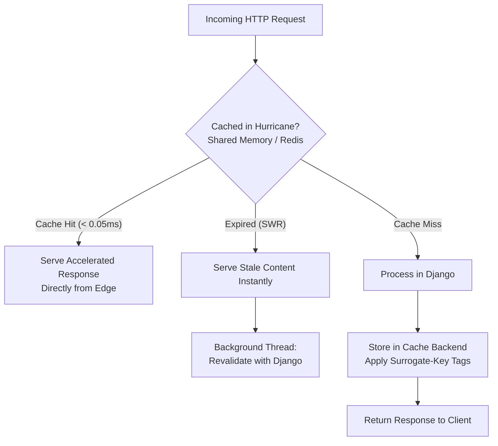
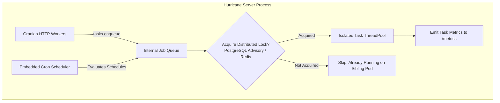
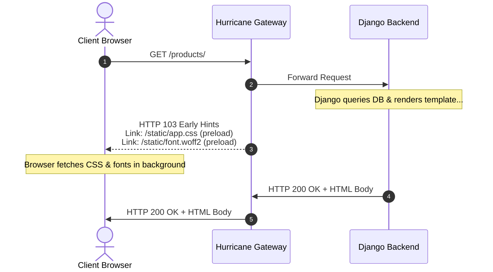
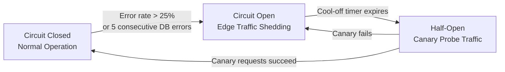

# Product Roadmap

Hurricane 2.0 reimagined what a modern Django application server can be by combining Granian's high-performance Rust networking with Django-native intelligence, edge security shields, and native asset streaming.

Our roadmap focuses on expanding Hurricane into a **complete, all-in-one production runtime** for Django—replacing bloated multi-container stacks (Gunicorn + Nginx + Varnish + Celery) with a single, resilient application server.

---

## Roadmap Overview

| Pillar | Feature | Target Scope | Impact |
| :--- | :--- | :--- | :--- |
| **Performance** | **[1. Django-Native HTTP Accelerator](#1-django-native-http-accelerator-varnish-replacement)** | Varnish Replacement | Full-page caching, SWR, tag invalidation via Django signals. |
| **Simplicity** | **[2. Background Tasks & Cron](#2-built-in-background-tasks--cron-celery-lite)** | Celery-Lite | Native Django Tasks backend, cron scheduler, multi-pod locking. |
| **Browser Speed** | **[3. HTTP 103 Early Hints](#3-http-103-early-hints)** | Asset Preloading | Stream preloads while Django renders; pending Granian upstream. |
| **Resilience** | **[4. Circuit Breakers & Degradation](#4-circuit-breakers--graceful-degradation)** | Outage Protection | Edge traffic shedding and fallback on database outages. |

---

## 1. Django-Native HTTP Accelerator (Varnish Replacement)

### The Challenge
High-traffic content portals, e-commerce stores, and media applications often place **Varnish Cache** in front of Django to survive traffic surges. While Varnish is fast, it introduces massive operational complexity:
- Writing and debugging esoteric **VCL (Varnish Configuration Language)**.
- Difficult SSL/TLS termination and multi-container routing.
- **Brittle Cache Invalidation**: Invalidating cache entries via custom HTTP `PURGE` or `BAN` headers often gets out of sync with Django model mutations, leading to stale content or cache stampedes.

### The Hurricane Solution
Hurricane will introduce an embedded **Tier 2 HTTP Accelerator** running directly in the gateway layer before requests enter the Python worker pool.



#### Key Capabilities
- **Surrogate-Keys & Tag-Based Invalidation**:
  Instead of brittle URL-based purging, views assign semantic tags:
  ```python
  from hurricane.accelerator import accelerate


  @accelerate(ttl=3600, tags=["article:102", "author:jane", "category:news"])
  def article_detail(request, slug): ...
  ```
  When an article or author is updated in the Django admin or via ORM, a standard `post_save` signal triggers:
  ```python
  from hurricane.accelerator import purge_tags


  def on_article_saved(sender, instance, **kwargs):
      purge_tags(f"article:{instance.pk}", "category:news")
  ```
  Hurricane instantly purges or marks all matching pages stale across the cluster with zero network roundtrips.

- **Stale-While-Revalidate (SWR) & Stale-If-Error**:
  When a cached page reaches its expiration time, Hurricane serves the stale response in **< 0.05 ms** while asynchronously triggering a background task to refresh the page with Django. If the database is undergoing a brief migration or outage, `stale-if-error` continues serving visitors without throwing 500 errors.

- **Built-in Django Cache Framework Integration**:
  The accelerator stores cached responses directly in Django's configured cache framework (`django.core.cache.caches["accelerator"]`):
  - **Single Pod / Dev**: Local-memory or POSIX shared memory.
  - **Multi-Pod Kubernetes**: Shared Redis, Valkey, or Memcached clusters for instant cross-replica synchronization.

- **Declarative Global Route Rules**:
  Configure caching policies across entire URL patterns in `settings.py` without touching view code:
  ```python [settings.py]
  HURRICANE_ACCELERATOR = {
      "ENABLED": True,
      "CACHE_BACKEND": "default",
      "ROUTES": [
          {"pattern": r"^/api/v1/catalog/", "ttl": 300, "swr": 60},
          {"pattern": r"^/blog/", "ttl": 3600, "swr": 300},
      ],
  }
  ```

---

## 2. Built-in Background Tasks & Cron ("Celery-Lite")

### The Challenge
Most Django applications only need to run periodic cleanup tasks (`clearsessions`, inventory imports) or defer lightweight background jobs (sending transactional emails, processing webhooks, resizing an avatar). 

Today, this requires deploying **Redis, a Celery worker container, and a Celery Beat scheduler**—adding 3+ containers, hundreds of megabytes of RAM overhead, and complex worker monitoring.

### The Hurricane Solution
Hurricane will provide a **zero-infrastructure background task and cron engine** embedded directly into the application server process, fully aligned with the upcoming **Django Background Tasks interface (DEP 0014)**.



#### Key Capabilities
- **DEP 0014 Native Task Backend**:
  Implement the official Django background tasks backend specification:
  ```python
  from django.tasks import task


  @task()
  def send_welcome_email(user_id: int):
      user = User.objects.get(pk=user_id)
      user.email_user("Welcome!", "Thank you for joining...")


  # In a view:
  send_welcome_email.enqueue(new_user.id)
  ```

- **Embedded Cron Scheduler**:
  Declare periodic tasks directly in `settings.py` supporting standard cron syntax, human shortcuts, and management command execution:
  ```python [settings.py]
  HURRICANE_CRON = [
      # Built-in Django command
      {
          "name": "clearsessions",
          "schedule": "0 3 * * *",  # Every night at 3:00 AM
          "command": "clearsessions",
      },
      # Custom command with arguments
      {
          "name": "sync-catalog",
          "schedule": "*/15 * * * *",  # Every 15 minutes
          "command": "sync_inventory",
          "args": ["--source=erp", "--verbose"],
      },
      # Direct Python callable
      {
          "name": "heartbeat",
          "schedule": "@hourly",
          "task": "myapp.tasks.ping_uptime_monitor",
      },
  ]
  ```

- **Multi-Pod Duplicate Prevention (Distributed Advisory Locks)**:
  When 10 Kubernetes pods run Hurricane simultaneously, only **one** pod executes the scheduled job. Hurricane acquires lightweight database advisory locks (`SELECT pg_try_advisory_lock(...)` on PostgreSQL, `GET_LOCK()` on MySQL) or atomic Redis cache locks (`SET NX`). Zero duplicate runs.

- **Efficient Long-Running Task Delays (Spanning Multiple Days)**:
  Schedule tasks days or weeks into the future (e.g. `send_followup.enqueue(user_id, delay=timedelta(days=7))`). Tasks are stored with scheduled timestamps in the database or Redis index, sleeping efficiently without holding idle worker threads open.

- **Deep Prometheus Observability**:
  Every task and cron job emits metrics to `/metrics` for real-time Grafana monitoring:
  - `hurricane_task_execution_seconds{task="send_welcome_email"}` (Histograms)
  - `hurricane_task_failures_total{task="sync-catalog"}` (Failure counters)
  - `hurricane_cron_last_run_timestamp{job="clearsessions"}`

---

## 3. HTTP 103 Early Hints

### The Challenge
When a browser requests an HTML page, it must wait for Django to connect to the database, render the template, and stream the HTML back before discovering what CSS stylesheets, JavaScript bundles, and web fonts it needs to download. This creates an avoidable 50–200 ms rendering bottleneck where the browser's network pipe sits idle.

### The Hurricane Solution
**HTTP 103 Early Hints** allows the server to send an informational response with `<link rel="preload">` headers **immediately upon receiving the request**, while Django is still processing the view.



#### Current Technical Status & Roadmap Plan
- **Current Limitation**: Granian proxies HTTP traffic using the Python ASGI/WSGI specifications, which do not currently expose an informational 1xx streaming response API to Python applications.
- **Roadmap Path**: We are collaborating with the Granian and Hyper ecosystem to introduce informational response support. Hurricane's configuration interface and `@early_hints` decorators are designed and ready to be connected once Granian exposes 103 streaming hooks over HTTP/2 and HTTP/3.

---

## 4. Circuit Breakers & Graceful Degradation

### The Challenge
When a PostgreSQL database reaches its connection pool limit or a third-party microservice experiences an outage, incoming traffic continues piling into Django worker threads. Requests hang until they hit reverse proxy timeouts, creating a cascading failure that prevents the database from recovering.

### The Hurricane Solution
An integrated **Edge Circuit Breaker** that monitors error rates and connection failures at the gateway layer, protecting backend resources from collapse.



#### Key Capabilities
- **Automated Circuit Tripping**:
  If database connection failures (`OperationalError`) or 5xx error rates exceed a configurable threshold within a sliding time window (e.g. 5 consecutive database drops in 3 seconds), the circuit opens immediately.
- **Instant Edge Traffic Shedding**:
  When the circuit is open, incoming requests are shed at Tier 2 in **< 0.35 microseconds** without touching Django worker threads or opening database connections.
- **Graceful Degradation**:
  - Serves cached responses from the **HTTP Accelerator** (stale-if-error).
  - Returns clean, styled maintenance pages with `Retry-After` headers.
- **Self-Healing Canary Probes**:
  After a cool-off interval (e.g. 10 seconds), the circuit transitions to **Half-Open**, permitting a small percentage of canary requests through to test database health. Once the database recovers, normal traffic resumes automatically.
- **Kubernetes Probe Coordination**:
  When the circuit trips, Hurricane temporarily sets the `/ready` probe to `HTTP 400`, instructing Kubernetes Ingress and AWS ALBs to divert traffic to healthy sibling pods until recovery completes.

---

## Get Involved & Shape the Roadmap

Hurricane is an open-source, community-driven project. We welcome your feedback, use cases, and code contributions:

- 💬 **Join the Discussion:** Chat with us on the [Blueshoe Discord Server](https://discord.gg/8NTPMVPaKy).
- 💡 **Feature Requests:** Open an issue or discussion on [GitHub](https://github.com/django-hurricane/django-hurricane/issues).
- 🏢 **Commercial Collaboration:** Partner with the core team at [Blueshoe](https://www.blueshoe.io) to sponsor or co-develop roadmap initiatives.
